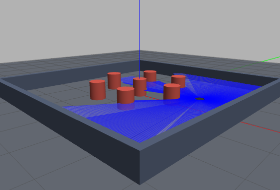
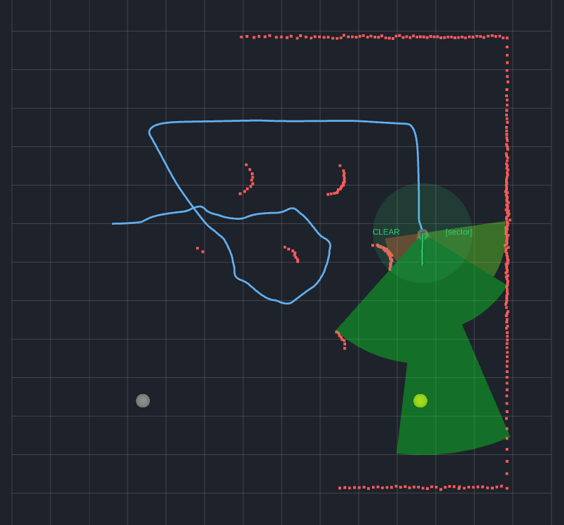
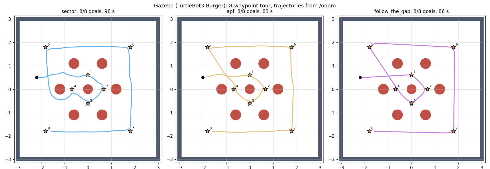
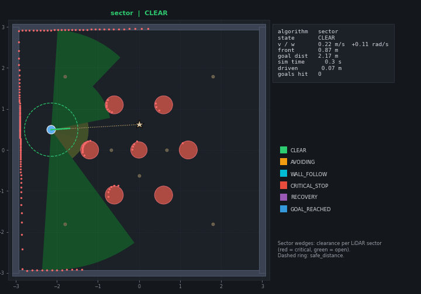
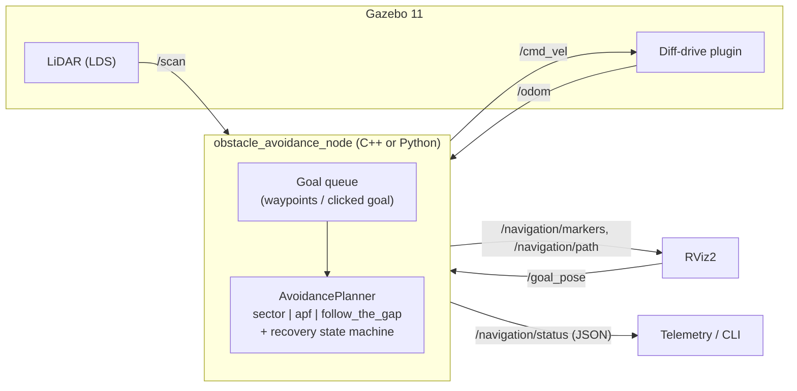

# Autonomous Robot Navigation and Obstacle Avoidance (ROS 2 + Gazebo)

[](https://github.com/anson10/Autonomous-Robot-Navigation-and-Obstacle-Avoidance-Using-ROS2-and-Gazebo/actions/workflows/ros2_ci.yml)


A reactive navigation stack for a **TurtleBot3 Burger** in **Gazebo** on **ROS 2 Humble**.
The navigation node reads the 360° LiDAR and odometry, drives to goals you click in RViz
(or a waypoint list), and avoids obstacles with one of three interchangeable local
planners: **multi-sector proportional control**, **artificial potential fields (APF)** and
**follow-the-gap**.

The node exists in two implementations with the same topics and parameters:

- **C++ (`my_robot_navigation_cpp`, rclcpp)**: the default. The planner is a ROS-free
  C++17 library with GoogleTest unit tests and a pybind11 module.
- **Python (`my_robot_navigation`, rclpy)**: the reference implementation, plus the 2D
  simulator, benchmark and dashboard.

A parity test feeds both planners the same scans and requires identical decisions (within
1e-9), and the benchmark can run either one, so every result below holds for both.

---

## Results

### Gazebo and RViz

| Gazebo 11: custom arena, TurtleBot3 Burger with LiDAR rays | RViz2: clearance wedges, heading, safety ring, goals, travelled path |
| :---: | :---: |
|  |  |

### Gazebo: 8-waypoint tour of the pillar arena



| Node | Planner | Goals reached | Tour time (sim s) | Distance driven (m) | Min clearance (m) |
| :--- | :--- | ---: | ---: | ---: | ---: |
| C++ | `sector` | 8/8 | 87 | 17.4 | 0.16 |
| C++ | `apf` | 8/8 | 84 | 17.1 | 0.17 |
| C++ | `follow_the_gap` | 8/8 | 86 | 17.4 | 0.15 |
| Python | `sector` | 8/8 | 98 | 18.1 | 0.10 |
| Python | `apf` | 8/8 | 83 | 16.9 | 0.17 |
| Python | `follow_the_gap` | 8/8 | 86 | 17.3 | 0.15 |

Recorded headless in Gazebo 11 with the real TurtleBot3 Burger model (LiDAR, differential
drive, physics); trajectories are the robot's `/odom`. Min clearance is the closest the
robot's edge (0.105 m radius) came to any pillar or wall. The planners are identical, so
differences between the C++ and Python rows come from Gazebo's run-to-run timing (for
example, Python `sector` went round a pillar on the other side near waypoint 4).
Reproduce with `scripts/gazebo_tour.sh <algorithm>` (`IMPL=python` for the Python node)
and `scripts/plot_gazebo_runs.py`.

### C++ vs Python planner

| Planner | Python median (µs) | C++ median (µs) | Python p99 (µs) | C++ p99 (µs) | Speed-up |
| :--- | ---: | ---: | ---: | ---: | ---: |
| `sector` | 1127 | 112 | 2120 | 292 | 10x |
| `apf` | 1347 | 130 | 2472 | 274 | 10x |
| `follow_the_gap` | 2042 | 166 | 3738 | 387 | 12x |

Time for one `plan()` call on 1,152 identical 360-beam scans from simulated episodes
(`scripts/planner_latency.py`, ROS Humble container, Python 3.10). The C++ times are
measured through the pybind11 module, so they include copying the scan into a
`std::vector`. Both are far inside the LiDAR's 200 ms scan period; the C++ node mainly
leaves headroom for denser sensors or a slower on-board computer. On the 50 unseen
benchmark scenarios, the C++ planner reproduces the Python results trial for trial
([`results/benchmark_seed2026_50_cpp.csv`](results/benchmark_seed2026_50_cpp.csv)).

### 2D benchmark: 50 random scenarios per planner

**Unseen scenarios (seed 2026)**: run once, after all planner changes were final.

| Planner | Success | Collision | Timeout | Time to goal (s) | Path efficiency | Min clearance (m) |
| :--- | ---: | ---: | ---: | ---: | ---: | ---: |
| `sector` | 100% | 0% | 0% | 24.7 | 0.92 | 0.16 |
| `apf` | 100% | 0% | 0% | 25.2 | 0.96 | 0.17 |
| `follow_the_gap` | 100% | 0% | 0% | 34.4 | 0.85 | 0.13 |

<details>
<summary>Development scenarios (seed 7), used while fixing APF and follow-the-gap</summary>

| Planner | Success | Collision | Timeout | Time to goal (s) | Path efficiency | Min clearance (m) |
| :--- | ---: | ---: | ---: | ---: | ---: | ---: |
| `sector` | 100% | 0% | 0% | 25.7 | 0.89 | 0.17 |
| `apf` | 100% | 0% | 0% | 23.3 | 0.98 | 0.18 |
| `follow_the_gap` | 96% | 0% | 4% | 30.8 | 0.88 | 0.14 |

The APF and follow-the-gap fixes (see Design notes) came from inspecting failures on this
seed, so it is not a held-out result; seed 2026 above is.
</details>

Each scenario is the arena plus 4 random extra pillars, with a random start pose and a goal
at least 2.5 m away. Every planner gets the **same** scenarios (90 s limit, default ROS
parameters). Path efficiency is straight-line distance divided by distance driven; min
clearance is the closest the robot's edge came to an obstacle, averaged over successful
runs. Raw per-trial data is in [`results/`](results/). Reproduce with
`ros2 run my_robot_navigation benchmark --trials 50 --seed 2026 --jobs 8`.

### Live 2D dashboard



`python3 visualize_simulation.py` (no ROS needed): the sector planner touring the same
arena, with per-sector clearance wedges, the safe-distance ring and a live readout.
Left-click sets a goal, right-click adds or removes pillars, and you can switch planner
and tune parameters live. This view uses simple unicycle kinematics; the Gazebo results
above are the physics-based check.

---

## Features

- **Three local planners**, switchable at launch or at runtime (`ros2 param set`):
  - `sector`: five LiDAR sectors with speed proportional to clearance and turn-direction
    hysteresis, so it does not chatter left/right in front of symmetric obstacles.
  - `apf`: attractive goal force plus Khatib-style repulsion with a small tangential
    component to break head-on deadlocks.
  - `follow_the_gap`: inflates obstacles by the robot radius, then steers into the gap
    closest to the goal.
- **Goal navigation from odometry**: click **2D Goal Pose** in RViz (`/goal_pose`), or pass
  a waypoint list (`waypoints:="x1,y1; x2,y2"`, optionally looped). The robot holds
  position after the last goal.
- **Recovery behaviours**: after sustained blockage it backs out (only if the rear sector
  is clear); if goal progress stalls inside a U-shaped pocket it switches to wall following.
- **Safety**: a watchdog stops the robot if `/scan` goes silent (`scan_timeout_s`), a zero
  velocity is published on shutdown and on pause, and parameter updates are validated
  (unknown planner names and inverted thresholds are rejected).
- **RViz2 visualisation**: per-sector clearance wedges coloured red to green, a heading
  arrow, a safety ring, a state label, goal markers and the travelled path
  (`/navigation/path`), all in a preconfigured `rviz/obstacle_avoidance.rviz`.
- **Telemetry**: JSON status on `/navigation/status` (state, velocities, sector distances,
  goal progress); services `/navigation/set_paused` and `/navigation/clear_goals`.
- **Custom Gazebo arena** (`worlds/obstacle_arena.world`): 6 m × 6 m with seven pillars.
  It is self-contained, with no `model://` includes, so it loads offline and in Docker.
- **Tested in CI** (`colcon test` in a `ros:humble-ros-base` container): 26 Python unit
  tests, 16 GoogleTest cases for the C++ planner, the C++/Python parity test, and the ROS
  linters (`flake8`, `pep257`, `cpplint`, `uncrustify`, `lint_cmake`, `xmllint`). The C++
  code builds with `-Wall -Wextra -Wpedantic -Werror`. Every CI run also posts benchmark
  tables for both implementations to the job summary.

---

## Architecture



States: `CLEAR` → `AVOIDING` → `CRITICAL_STOP` → `RECOVERY`, plus `WALL_FOLLOW`,
`GOAL_REACHED` and `PAUSED`.

```text
src/
├── my_robot_navigation_cpp/          C++ package (ament_cmake)
│   ├── include/.../avoidance_planner.hpp   planner library, no ROS
│   ├── src/avoidance_planner.cpp
│   ├── src/obstacle_avoidance_node.cpp     rclcpp node
│   ├── src/python_bindings.cpp             pybind11 module for benchmark/parity
│   └── test/                               GoogleTest + parity test
└── my_robot_navigation/              Python package (ament_python)
    ├── my_robot_navigation/              reference planner, rclpy node, sim2d, benchmark
    ├── launch/ config/ rviz/ worlds/     shared by both nodes
    └── test/
```

---

## Quick start

### Docker (no ROS install needed)

```bash
xhost +local:docker
docker compose up --build          # Gazebo + RViz, C++ node, sector planner, free exploration
```

### Native (Ubuntu 22.04 + ROS 2 Humble)

```bash
sudo apt install ros-humble-turtlebot3 ros-humble-turtlebot3-gazebo python3-colcon-common-extensions
git clone https://github.com/anson10/Autonomous-Robot-Navigation-and-Obstacle-Avoidance-Using-ROS2-and-Gazebo.git
cd Autonomous-Robot-Navigation-and-Obstacle-Avoidance-Using-ROS2-and-Gazebo
source /opt/ros/humble/setup.bash
rosdep install --from-paths src --ignore-src -y     # C++ build deps (pybind11, gtest, ...)
colcon build --symlink-install && source install/setup.bash
ros2 launch my_robot_navigation robot_navigation.launch.py use_rviz:=true
```

---

## Usage

```bash
# Click goals in RViz with the "2D Goal Pose" tool
ros2 launch my_robot_navigation robot_navigation.launch.py use_rviz:=true algorithm:=apf

# Same, with the Python node instead of the C++ one
ros2 launch my_robot_navigation robot_navigation.launch.py use_rviz:=true impl:=python

# Patrol a waypoint loop
ros2 launch my_robot_navigation robot_navigation.launch.py \
  waypoints:="-1.8,1.8; 1.8,1.8; 1.8,-1.8; -1.8,-1.8" loop_waypoints:=true

# Stock TurtleBot3 world, headless
ros2 launch my_robot_navigation robot_navigation.launch.py world:=turtlebot3_world gui:=false

# Runtime control
ros2 param set /obstacle_avoidance_node algorithm follow_the_gap
ros2 service call /navigation/set_paused std_srvs/srv/SetBool "{data: true}"
ros2 service call /navigation/clear_goals std_srvs/srv/Trigger
ros2 topic echo /navigation/status
```

| Launch argument | Default | Meaning |
| :--- | :--- | :--- |
| `impl` | `cpp` | `cpp` (rclcpp node) or `python` (rclpy node) |
| `world` | `arena` | `arena`, `turtlebot3_world`, or a path to a `.world` file |
| `x_pose`, `y_pose` | per world | Spawn position |
| `algorithm`, `safe_distance`, `waypoints`, `loop_waypoints` | YAML value | Override `config/navigation_params.yaml` only when given |
| `gui` / `use_rviz` / `use_gazebo` | `true` / `false` / `true` | Gazebo client, RViz2, Gazebo itself |
| `params_file` | `config/navigation_params.yaml` | Full parameter file |

All node parameters, with comments, are in
[`config/navigation_params.yaml`](src/my_robot_navigation/config/navigation_params.yaml).

---

## Tests and benchmark

```bash
colcon test && colcon test-result --verbose          # both packages, all tests and linters
ros2 run my_robot_navigation benchmark --trials 50 --seed 2026 --impl cpp --jobs 8
python3 scripts/planner_latency.py                   # C++ vs Python plan() timing
# Python planner without ROS:
PYTHONPATH=src/my_robot_navigation pytest src/my_robot_navigation/test -q
```

---

## Design notes

- **APF near walls.** Plain APF often can't reach a goal that sits close to a wall: the
  wall's repulsion cancels the goal's pull and the robot circles about 0.4 m away (the
  "goal non-reachable with obstacles nearby" problem). Repulsion is therefore scaled by
  `(d_goal / d_influence)²` (Ge & Cui, 2000), and obstacles farther away than the goal are
  ignored because they cannot block it. On the development scenarios this raised APF
  from 54% to 80% success.
- **APF and LiDAR resolution.** Summing one repulsive force per beam makes a wall push
  harder the more beams hit it, so the behaviour depended on sensor resolution, and the
  net force often pointed backwards. Each beam is now weighted by its angular width
  (`angle_increment`), which turns the sum into an integral over the field of view.
  This took APF from 80% to 100% on the development scenarios, with the default gain.
- **Follow-the-gap with a goal.** The classic version heads for the widest gap, even when
  it points away from the goal, so the robot wandered. It now chooses the gap closest to
  the goal bearing and aims at the point inside it nearest the goal (46% → 96% on the
  development scenarios).
- **Free-space assumptions.** Readings below `range_min` or infinite are treated as free
  space. That matches the simulated LDS (no return means nothing within 3.5 m), but a
  blinded or failed sensor would read as open space, so on hardware you would treat those
  readings more carefully.

## Limitations

- Purely reactive: there is no map and no global planner, so a goal behind a long wall or
  in a maze can still fail (the trap detector helps with U-shaped pockets only).
- Tested in simulation only (Gazebo and the 2D simulator), not on a physical TurtleBot3.
- The 2D benchmark uses unicycle kinematics with no inertia, slip or sensor noise, so it
  compares planners against each other; the Gazebo runs are the physics-based check.
- Goals must be given in the `odom` frame (equal to Gazebo world coordinates in
  simulation); there is no TF lookup for goals in other frames.
- Unit and parity tests cover the planners; the nodes' ROS wiring (topics, parameters,
  goal queue) is checked by the Gazebo runs rather than by node-level tests. On Humble,
  `ament_cppcheck` skips itself (cppcheck 2.7 is flagged as too slow), so C++ static
  analysis comes from the compiler warnings and `cpplint` only.

## License

MIT. See [LICENSE](LICENSE).
